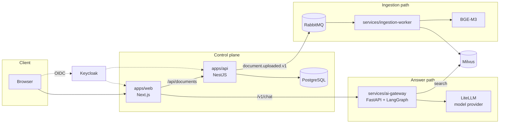
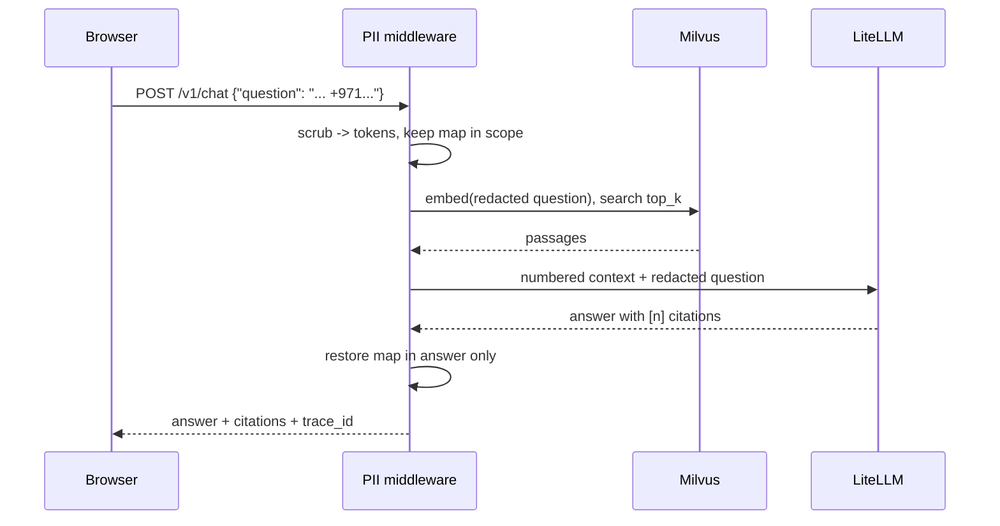

# Architecture

Amanah RAG is split into a synchronous answer path and an asynchronous ingestion path. The
split exists so that a slow embedding model or a Milvus hiccup cannot block uploads, and a
traffic spike on chat cannot starve ingestion.

## Components

| Component                 | Owns                                              | Does not own                        |
| ------------------------- | ------------------------------------------------- | ----------------------------------- |
| `apps/web`                | Presentation, language switch, citation rendering | Retrieval, prompting                |
| `apps/api`                | Document metadata, job history, auth boundary     | Chunk text, vectors, model calls    |
| `services/ai-gateway`     | PII boundary, retrieval, prompt, generation       | Persistence, ingestion              |
| `services/ingestion-worker` | Chunking, embeddings, Milvus writes             | HTTP traffic, user requests         |
| `packages/contracts`      | Wire formats                                      | Runtime behaviour                   |
| `infra/compose`           | Local dependencies                                | Production orchestration            |

## Answer path

1. The browser posts `{question, language}` to the gateway.
2. `PIIMiddleware` buffers the JSON body, replaces sensitive values with request-scoped
   tokens, and stores the token map on the ASGI scope. From here on, nothing downstream can
   see raw PII.
3. The LangGraph `retrieve` node embeds the redacted question and searches Milvus, filtered
   by language.
4. `generate` builds a numbered context and calls LiteLLM with a citation-mandating prompt.
   With no model configured it returns an extractive stub instead.
5. `restore` rehydrates the caller's own tokens in the answer only. Citations keep the
   redacted chunk text.
6. The response returns `trace_id`, `model`, `latency_ms` and the citations used.

## Ingestion path

1. `POST /api/documents` writes metadata and an `IngestionJob` row.
2. The API is meant to publish `document.uploaded.v1`; that handoff is not wired yet
   (ADR 0002).
3. The worker validates the event, chunks the text, embeds batches with BGE-M3 and upserts
   vectors into Milvus. Re-ingesting a document deletes its old vectors first, so chunk-count
   changes do not leave orphans.
4. Failures are rejected without requeue and land in `document.uploaded.v1.dlq`.

## Trust boundaries

| Boundary              | Rule                                                        |
| --------------------- | ----------------------------------------------------------- |
| Browser → gateway     | No auth in the skeleton; Keycloak is provisioned, guard is a follow-up. |
| Gateway → model       | Only tokenised text leaves the process.                     |
| Gateway → Milvus      | Chunk text stored redacted at ingest time is a **non-goal** for now; raw document text is indexed. Do not ingest real PII until that changes. |
| Worker → events       | Unknown fields are rejected; malformed messages go to the DLQ. |

The last row is the most important limitation in this skeleton: redaction protects the model
call path, not the vector store. Ingesting production documents requires either scrub-on-write
or a private, access-controlled Milvus. Tracked in ADR 0003.

## Deliberate non-goals

- No reranker yet. `top_k=5` from a single embedding model is the baseline to beat.
- No conversation memory. Each request is independent; follow-ups must be self-contained.
- No streaming. The UI waits for a complete, citation-checked answer.
- No multi-tenant isolation. One corpus, one Milvus collection.

## Failure modes

| Failure                  | Behaviour                                            |
| ------------------------ | ---------------------------------------------------- |
| Milvus unreachable       | Retrieval returns `[]`; answer says no sources matched. |
| Model provider error     | Request fails with 502; no uncited answer is served.  |
| Malformed event          | Rejected to DLQ; ingestion does not loop.             |
| Database unreachable     | `/api/health` reports `degraded`; process stays up.   |
| Embedding dim mismatch   | Gateway raises rather than comparing incomparable vectors. |
